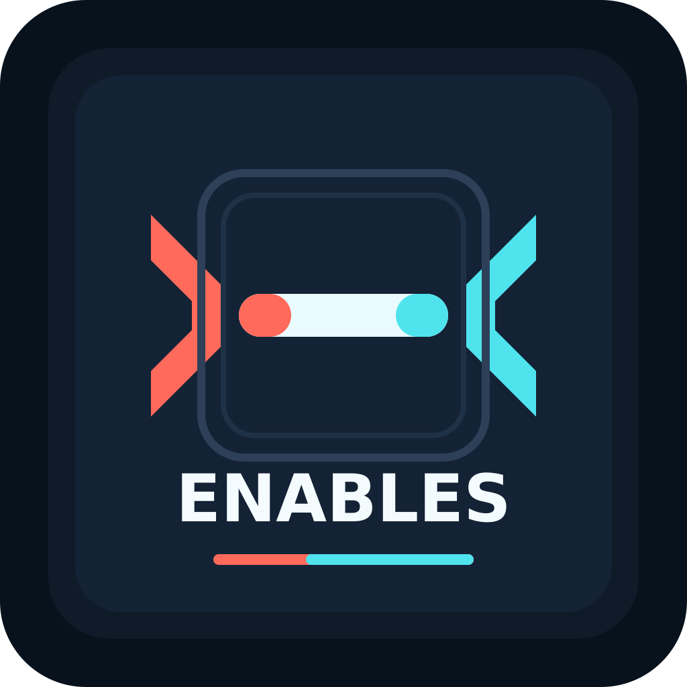
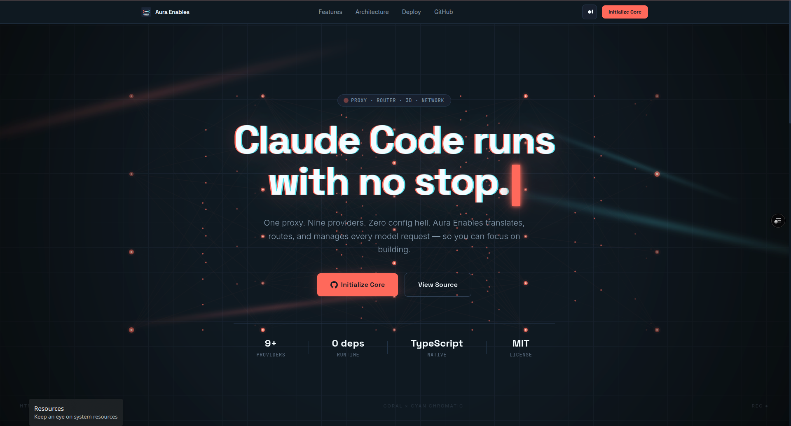

# Enables

**Make Claude Code work with almost any AI provider.**

Enables is a lightweight, high-performance local proxy that lets Claude Code sign in through an Anthropic-compatible local endpoint while routing model requests to your chosen upstream provider (DeepSeek, Google Gemini, OpenAI, Groq, Ollama, OpenRouter, xAI, Mistral, and more).

Built by **Lean Progress IQ** and **Dusan Milosavljevic**, builder of **Aura Code** and **Aura Pulse**. Enables gives developers complete freedom to select, swap, and control the models behind their coding agents.

<p align="center">
  <a href="https://github.com/DusanCar-sudo/enables/releases"></a>
  <a href="https://github.com/DusanCar-sudo/enables/blob/main/LICENSE"></a>
  <a href="https://www.typescriptlang.org/"></a>
  <a href="https://nodejs.org/">= 22" /></a>
  <a href="https://github.com/DusanCar-sudo/enables"></a>
  <a href="https://github.com/DusanCar-sudo/enables"></a>
</p>

---

<p align="center">
  
</p>

```text
      ◢◤                               ◢◤
   ╭─────────────────────────────────────────────────╮
   │   AURA   CODE                                   │
   │        E N A B L E S                            │
   │    local gateway for Claude Code                │
   ╰─────────────────────────────────────────────────╯
      ◥◣                               ◥◣
```

---

<p align="center">
  
</p>

---

## Quickstart & User Manual

### 1. Installation

Build from source or link locally:

```bash
git clone https://github.com/DusanCar-sudo/enables.git
cd enables
npm install
npm run build
npm run global # or: npx tsx src/index.ts
```

---

### 2. Running Enables

Start Enables from your terminal:

```bash
enables
```

You will see the interactive terminal menu:

1. **Select Provider**: Choose from DeepSeek, Google Gemini, OpenAI, Ollama, OpenRouter, Groq, xAI, Xiaomi MiMo, Zhipu GLM, or a custom OpenAI-compatible endpoint.
2. **Enter API Key**: Paste your provider API key (hidden prompt) or rely on environment variables (e.g. `DEEPSEEK_API_KEY`, `GOOGLE_API_KEY`, `OPENAI_API_KEY`).
3. **Select Target Model**: Choose the model you want to power Claude Code (e.g., `gemini-2.0-flash`, `deepseek-chat`, `gpt-4o`, `qwen2.5-coder:32b`).
4. **Start Proxy**: Enables automatically scans for an open TCP port (starting at `8080`, falling back to `8081`, `8082`, etc. if occupied) and launches Claude Code with the local proxy configured.

---

### 3. Connecting Claude Code to Enables

When Claude Code launches through Enables, follow these steps during initial login:

#### Step A: Choose Login Method in Claude Code

When Claude Code prompts:

```text
Select login method:
  1. Claude account with subscription · Pro, Max, Team, or Enterprise
❯ 2. Anthropic Console account · API usage billing
  3. 3rd-party platform · Amazon Bedrock, Microsoft Foundry, or Vertex AI
```

👉 **Select `2. Anthropic Console account · API usage billing`**.

> **Why?** Option 1 (subscription login) attempts web OAuth authentication through Anthropic servers. Option 2 instructs Claude Code to use API Key authentication, which routes through your local Enables proxy endpoint (`ANTHROPIC_BASE_URL=http://localhost:<port>`).

#### Step B: API Key Prompt in Claude Code

When Claude Code prompts for an API Key, press **Enter** or type `dummy`. Enables manages your real provider API key securely in your local configuration (`~/.enables.json`).

#### Step C: Choosing a Model in Claude Code (`/model`)

Inside Claude Code, you can run `/model` or keep the default selection:

👉 **Select `Sonnet` (default)**.

> **Why?** Enables automatically advertises standard Claude model identifiers (`claude-sonnet-4-6`, `claude-opus-4-8`, `claude-3-7-sonnet-20250219`, etc.) on the `/v1/models` endpoint to satisfy Claude Code's model validation. When requests arrive at the proxy, Enables transparently translates and routes the request to your configured upstream model (e.g., Google Gemini 2.0 Flash, DeepSeek V3, GPT-4o).

---

### 4. Resuming Previous Sessions

If you exit or stop midway through work, you can resume your exact Claude Code session directly through Enables without losing context:

#### Via Command-Line Flags:
```bash
# Resume a specific session by UUID
enables --resume f46bd1a5-bd3d-4ac7-87ca-8365ae6f978b

# Short flag
enables -r f46bd1a5-bd3d-4ac7-87ca-8365ae6f978b

# Continue the most recent session in the current directory
enables --continue # or: enables -c

# Open Claude Code's interactive session picker
enables --resume   # or: enables -r
```

#### Via Interactive Terminal Menu:
Simply run `enables` and select:
* `2. ↺ Continue last session` (runs `claude -c`)
* `3. ⧉ Resume session by ID` (prompts for session UUID or opens interactive selector)

---

### 5. Automatic Free Port Detection

Enables includes an integrated port scanner and generator. If port `8080` is currently used by another process or proxy instance, Enables will:
1. Scan ports starting from `8080` (e.g. `8081`, `8082`, ...).
2. Bind to the first free TCP port automatically.
3. Update the `ANTHROPIC_BASE_URL` environment variable passed to Claude Code.

You will never encounter `EADDRINUSE` or `Port in use` crashes.

---

### 6. Token Saver & Real-Time Cache Tracking

Enables includes **Token Saver**, a real-time request tracking meter that monitors:
- Input request tokens & output tokens.
- Provider prompt cache hits (e.g., DeepSeek / Gemini prompt caching).
- Cumulative session token savings directly in terminal output.

---

### 7. Advanced Gateway Capabilities (v0.2.0)

- **Multimodal Vision Support**: Base64 images passed by Claude Code (screenshots, diagrams, UI wireframes) are automatically translated into standard OpenAI `image_url` data URLs (`data:${media_type};base64,...`) for vision-capable models (e.g. GPT-4o, Gemini 2.0/2.5).
- **Reasoning / Thinking Delta Streaming**: Live reasoning content from models like DeepSeek-R1, QwQ, and o3-mini (`delta.reasoning_content`) is dynamically translated into Anthropic `thinking` content blocks.
- **Parallel Tool Call Synchronization**: Dedicated state machine tracks parallel tool invocations and ensures interleaved argument chunks never desynchronize Anthropic SSE stream blocks.
- **Automatic Message Consolidation**: Auto-merges consecutive assistant turns (text + tool_use) into single compliant messages to satisfy strict OpenAI/Mistral validation schemas.
- **Dynamic Context Budgeting**: `/v1/messages/count_tokens` computes real token estimates from payload content so Claude Code accurately manages context compaction.
- **SSE Keep-Alive Heartbeats**: Sends periodic `: ping\n\n` SSE comments every 15 seconds during long-running tool executions to prevent idle connection resets (`ECONNRESET`).

---

### 8. Automatic Provider Failover (v0.4.0)

Enables now keeps your session alive when a provider dies. When the active provider fails with **401/403** (bad key), **402 / quota / insufficient balance**, **429** (rate limit), **5xx**, a network error, or a timeout, the same request is automatically retried on the next provider in the failover chain — free tiers first, paid providers last:

```text
your configured provider → groq → openrouter → google → nvidia → github-models
  → cerebras → cloudflare-workers-ai → mistral → opencode-zen → modelscope → llm7
  → deepseek → openai → anthropic → xai → together → fireworks → perplexity
  → sambanova → cohere → zhipu → dashscope → moonshot → baichuan
```

- Providers with no available API key (env var unset, nothing in config) are **silently skipped**.
- Every failover is logged: `[failover] groq 429 rate_limit → trying openrouter`.
- The chain order can be overridden in `~/.enables.json` or per run.
- **Limitation**: a provider that dies mid-stream (after the first byte reached Claude Code) cannot be retried — failover applies up to the point a response starts.

#### Configuring keys for failover

Failover reads keys from env vars (`GROQ_API_KEY`, `OPENROUTER_API_KEY`, …) or from a per-provider map in `~/.enables.json`:

```json
{
  "provider": "groq",
  "providers": {
    "google": { "apiKey": "AIza...", "model": "gemini-2.5-pro" },
    "deepseek": { "apiKey": "sk-..." }
  },
  "failover": true,
  "failoverChain": ["groq", "google", "deepseek"]
}
```

Set `"failover": false` to disable (or pass `--no-failover`), and `"failoverChain"` for an explicit order (or pass `--chain groq,google,deepseek`).

#### Controlling the proxy from inside Claude Code

While the proxy runs, you can inspect and steer it — including directly from Claude Code's **Bash tool**:

```bash
enables status             # active provider, chain, key sources, per-provider errors, counters
enables switch deepseek    # make deepseek the active provider for subsequent requests
enables next               # advance to the next provider in the chain
```

The proxy also exposes raw control endpoints on localhost: `GET /__enables/status`, `POST /__enables/switch {"provider":"<id>"}`, `POST /__enables/next`.

### 9. Launch-Environment Preflight (v0.4.1)

Enables spawns Claude Code with `ANTHROPIC_BASE_URL=http://localhost:<port>` + `ANTHROPIC_API_KEY`. If `claude` on your PATH is a wrapper script that unsets `ANTHROPIC_BASE_URL` for localhost addresses (a cleanup pattern common in router-era setups — tokenharbor, z.ai), the injection dies before Claude Code starts: the proxy sits idle, no Token Saver lines appear, and Claude answers from its stock backend. Symptom: Enables "runs" but the provider never receives a request.

Check your launcher before wasting a session on it:

```bash
npm run preflight          # resolves `claude` from PATH and scans it
npm run preflight -- --bin /path/to/claude   # explicit launcher override
```

- A **guarded** cleanup (an `ANTHROPIC_API_KEY` mention near the unset's conditional) is fine — it keeps deliberate proxy injections alive.
- An **unguarded** strip is reported with the exact lines and fix guidance: keep a localhost base URL when an API key accompanies it; only strip keyless, unmanaged leftovers.

Exit codes: `0` clean, `1` hostile launcher, `2` `claude` not found.

---

## Supported Providers & Presets

| Provider | Preset ID | Default Model | Adapter |
|---|---|---|---|
| **DeepSeek** | `deepseek` | `deepseek-v4-pro` / `deepseek-v4-flash` / `deepseek-chat` | OpenAI-compatible |
| **Google Gemini** | `google` | `gemini-2.0-flash` | OpenAI-compatible |
| **OpenAI** | `openai` | `gpt-4o` / `o3-mini` | OpenAI-compatible |
| **OpenRouter** | `openrouter` | `deepseek-chat` | OpenAI-compatible |
| **Groq** | `groq` | `llama-3.3-70b-versatile` | OpenAI-compatible |
| **xAI (Grok)** | `xai` | `grok-3` | OpenAI-compatible |
| **Ollama (Local)** | `ollama` | `gemma3:12b` | OpenAI-compatible |
| **OpenCode** | `opencode-zen` / `opencode-go` | `opencode-zen` | OpenAI-compatible |
| **Xiaomi MiMo** | `mimo-token` / `mimo-payg` | `mimo-v2-flash` | OpenAI-compatible |
| **Zhipu GLM** | `zhipu` | `glm-4-flash` | OpenAI-compatible |
| **Mistral AI** | `mistral` | `mistral-large-latest` | OpenAI-compatible |
| **Together AI** | `together` | `Llama-3.3-70B-Instruct-Turbo` | OpenAI-compatible |
| **Fireworks AI** | `fireworks` | `llama-v3p3-70b-instruct` | OpenAI-compatible |
| **Perplexity** | `perplexity` | `sonar-pro` | OpenAI-compatible |
| **Cerebras** | `cerebras` | `llama-3.3-70b` | OpenAI-compatible |
| **NVIDIA NIM** | `nvidia` | `meta/llama-3.3-70b-instruct` | OpenAI-compatible |
| **GitHub Models** | `github-models` | `openai/gpt-4o-mini` | OpenAI-compatible |
| **Cloudflare Workers AI** | `cloudflare-workers-ai` | `@cf/meta/llama-3.1-8b-instruct` | OpenAI-compatible |
| **ModelScope** | `modelscope` | `Qwen/Qwen2.5-Coder-32B-Instruct` | OpenAI-compatible |
| **LLM7.io (free gateway)** | `llm7` | `gpt-4o-mini` | OpenAI-compatible |
| **SambaNova** | `sambanova` | `Meta-Llama-3.3-70B-Instruct` | OpenAI-compatible |
| **Cohere** | `cohere` | `command-r7b-12-2024` | OpenAI-compatible |
| **Alibaba DashScope** | `dashscope` | `qwen-max` | OpenAI-compatible |
| **Moonshot (Kimi)** | `moonshot` | `kimi-k2-0711-preview` | OpenAI-compatible |
| **Baichuan** | `baichuan` | `Baichuan4` | OpenAI-compatible |
| **Anthropic** | `anthropic` | `claude-sonnet-4-20250514` | Native pass-through |
| **Custom Endpoint** | `custom` | *User specified* | OpenAI-compatible |

---

## Environment Variable Fallbacks

You can pre-configure API keys in your shell profile (`~/.bashrc`, `~/.zshrc`):

```bash
export DEEPSEEK_API_KEY=sk-...
export GOOGLE_API_KEY=AIza...
export OPENAI_API_KEY=sk-proj-...
export OPENROUTER_API_KEY=sk-or-...
export GROQ_API_KEY=gsk_...
export XIAOMI_API_KEY=tp-...
export GITHUB_MODELS_API_KEY=github_pat_...
export CLOUDFLARE_API_TOKEN=...        # plus CLOUDFLARE_ACCOUNT_ID=...
export MODELSCOPE_API_KEY=ms-...
export LLM7_API_KEY=...                # optional; llm7 works keyless (rate-limited)
export SAMBANOVA_API_KEY=...
export COHERE_API_KEY=...
```

---

## Architecture

```text
Claude Code CLI
  └─► Anthropic Messages API Request (localhost:<port>)
        └─► Enables Local Gateway Proxy
              ├─► Port Scanner / Auto Free Port Resolver
              ├─► Request Translator (Anthropic ◄► OpenAI Format + Vision data URLs)
              ├─► Upstream Provider API (DeepSeek, Gemini, OpenAI, Ollama, etc.)
              └─► Response Stream Converter (SSE ◄► Anthropic SSE + Thinking Blocks)
                    ├─► SSE Keep-Alive Heartbeat (: ping)
                    └─► Anthropic-compatible SSE Response to Claude Code
```

---

## Endpoints

| Method | Path | Purpose |
|--------|------|---------|
| `POST` | `/v1/messages` | Main proxy endpoint (Anthropic → provider with streaming + failover) |
| `POST` | `/v1/messages/count_tokens` | Dynamic token counter for context budgeting |
| `GET` | `/health` | Proxy status — provider, model, active failover provider |
| `GET` | `/v1/models` | Model validation list (unions models of all keyed failover providers) |
| `GET` | `/__enables/status` | Failover status: active provider, chain, counters |
| `POST` | `/__enables/switch` | `{"provider":"<id>"}` — switch the active provider |
| `POST` | `/__enables/next` | Advance to the next provider in the chain |

---

## Development & Testing

```bash
# Install dependencies
npm install

# Build TypeScript to dist/
npm run build

# Run unit test suite
npm test
```

---

## Credits & Philosophy

Enables is built by **Lean Progress IQ** and **Dusan Milosavljevic**.

Dusan Milosavljevic is the creator of **Aura Code** and **Aura Pulse**. Enables reflects our core mission: practical, developer-centric infrastructure that puts developers in complete control of their AI models, tooling, and workflows.
